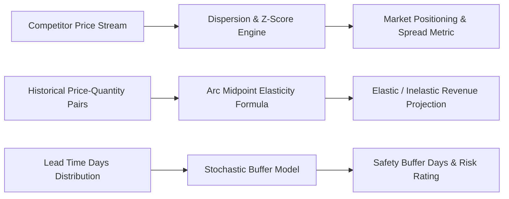

# genpark-accio-market-intelligence


GenPark Accio Market Intelligence has a standard-library core for e-commerce pricing and competitive intelligence engine implementing market price dispersion variance and Z-score analytics, arc midpoint price elasticity of demand (PED) modeling, and supply chain lead-time volatility buffer calculations.



## MCP runtime requirements

Use Python 3.10 or newer. The core `client.py` uses only the standard library; `mcp_server.py` requires the official `mcp` SDK (`mcp>=1.0.0,<2`). From this repository's checkout, create an isolated environment and install its requirements:

```bash
python -m venv .venv
.venv/bin/python -m pip install -r requirements.txt
```

On Windows, use `.venv\Scripts\python.exe` instead. You may use an existing Python environment with the requirements installed. Configure your MCP client with that interpreter's absolute path and the absolute path to `mcp_server.py`. The client launches a local STDIO process; the GitHub repository URL is not a remote MCP endpoint.

Example client configuration (replace the placeholder paths):

```json
{
  "mcpServers": {
    "genpark-accio-market-intelligence": {
      "command": "/absolute/path/to/genpark-accio-market-intelligence/.venv/bin/python",
      "args": [
        "/absolute/path/to/genpark-accio-market-intelligence/mcp_server.py"
      ]
    }
  }
}
```

## Features
- **Price Dispersion & Z-Score**: Evaluates competitive pricing distributions, standard deviation, and quartile spreads.
- **Arc Midpoint Elasticity (PED)**: Quantifies volume sensitivity to pricing adjustments and computes prospective revenue impact curves.
- **Supply Chain Lead-Time Risk**: Projects required safety stock buffer days based on supplier historical variance and reliability scores.

## Quickstart

```python
from client import GenParkAccioMarketIntelligence

intel = GenParkAccioMarketIntelligence()
res = intel.calculate_market_price_dispersion_and_variance([39.99, 44.50, 49.00, 52.50, 59.99], 49.00)
print("Market Position:", res["market_position"], "Z-Score:", res["baseline_z_score"])
```

## License
MIT
