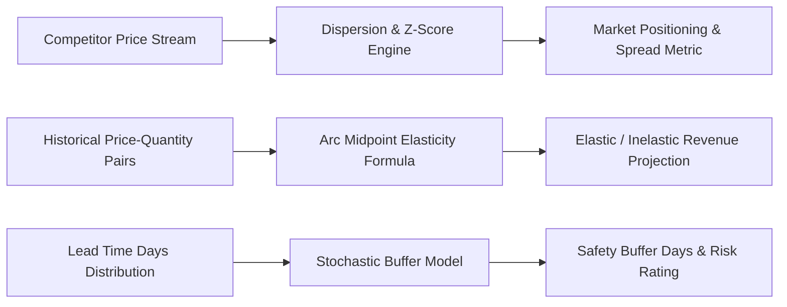

# genpark-accio-market-intelligence


GenPark Accio Market Intelligence is a zero-dependency e-commerce pricing and competitive intelligence engine implementing market price dispersion variance and Z-score analytics, arc midpoint price elasticity of demand (PED) modeling, and supply chain lead-time volatility buffer calculations.



## Features
- **Price Dispersion & Z-Score**: Evaluates competitive pricing distributions, standard deviation, and quartile spreads.
- **Arc Midpoint Elasticity (PED)**: Quantifies volume sensitivity to pricing adjustments and computes prospective revenue impact curves.
- **Supply Chain Lead-Time Risk**: Projects required safety stock buffer days based on supplier historical variance and reliability scores.

## Quickstart

```python
from client import GenParkAccioMarketIntelligence

intel = GenParkAccioMarketIntelligence()
res = intel.calculate_market_price_dispersion_and_variance([39.99, 44.50, 49.00, 52.50, 59.99], 49.00)
print("Market Position:", res["market_position"], "Z-Score:", res["baseline_z_score"])
```

## License
MIT
